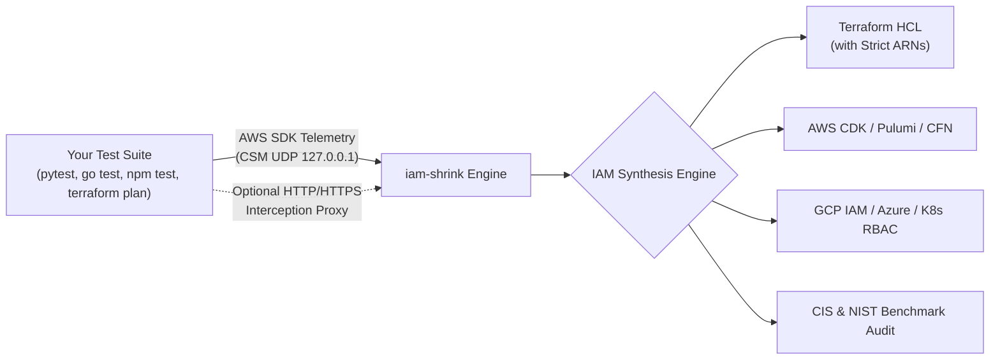

# iam-shrink

<p align="center">
  <strong>Local-to-Least-Privilege AWS IAM Policy Generator</strong><br>
  <em>Intercept AWS operations during local test suites, scripts, or deployment dry runs and automatically synthesize exact, least-privilege IAM policies.</em>
</p>

<p align="center">
  <a href="https://github.com/smford/iam-shrink/actions/workflows/ci.yml"></a>
  <a href="https://goreportcard.com/report/github.com/smford/iam-shrink"></a>
  <a href="https://github.com/smford/iam-shrink/releases"></a>
  <a href="https://ghcr.io/smford/iam-shrink"></a>
  <a href="https://github.com/smford/iam-shrink/blob/main/LICENSE"></a>
  <a href="https://smford.github.io/iam-shrink/"></a>
</p>

> 📚 **Interactive Documentation Portal**: Visit [**smford.github.io/iam-shrink**](https://smford.github.io/iam-shrink/) for instant search, interactive architecture diagrams, language playbooks, and dark mode reading powered by [`md-web-renderer`](https://github.com/smford/md-web-renderer).
> You can also browse the [Documentation Hub on GitHub](docs/README.md).

---

## What is iam-shrink? (In Simple Terms)

When developers write code that talks to AWS (like reading from an S3 bucket or saving to DynamoDB), they usually do not know the exact list of obscure AWS IAM action names and ARNs required.

Because getting "Access Denied" errors slows down development, developers and teams routinely slap on `AdministratorAccess` or broad wildcard policies (`Action: "*", Resource: "*"`). These over-privileged policies make it into staging and production, exposing organizations to massive data breaches, privilege escalation, and compliance audit failures.

**`iam-shrink` solves this automatically.**

It acts like a transparent observer. When you run your existing test suite (e.g. `go test`, `pytest`, `npm test`, or `terraform plan`), `iam-shrink` quietly watches every AWS call your code makes in real time with **zero cloud credentials**. It then writes the **exact, minimal security policy** needed to run your application—formatted in **Terraform HCL**, **AWS CDK**, **CDKTF**, **Pulumi**, **CloudFormation**, **AWS Identity Center (SSO)**, **GCP IAM**, **Azure RBAC**, **Kubernetes RBAC**, or **JSON**.

---

## How It Works: Zero-Credential Telemetry



1. **Local Interception**: Prefix your test command with `iam-shrink run -- <cmd>`. `iam-shrink` starts a lightweight loopback UDP listener on `127.0.0.1` and passes `AWS_CSM_ENABLED=true` to the test process.
2. **Standard AWS SDK Telemetry**: Every official AWS SDK (Go, Python/Boto3, Node.js `@aws-sdk`, Java, .NET) natively emits microsecond telemetry datagrams for every API call.
3. **Instant Synthesis**: When the command finishes, `iam-shrink` correlates the calls, looks up IAM permissions in its embedded database, parameterizes ARNs, and generates clean infrastructure code.

---

## Why iam-shrink vs Alternatives?

| Capability | `iam-shrink` | AWS IAM Access Analyzer | Policy Sentry | CloudTracker |
|---|:---:|:---:|:---:|:---:|
| **Feedback Loop** | **Instant (Local Test Run)** | Delayed (15-30m CloudTrail) | Manual list compile | Batch CloudTrail sync |
| **AWS Credentials Required?** | **No (Zero-Cloud Loopback)** | Yes (Live AWS Account) | No | Yes (AWS Athena/S3) |
| **In-Place Terraform Patching** | **Yes (`iam-shrink patch`)** | No | No | No |
| **Multi-Cloud (GCP, Azure, K8s)** | **Yes (Native Translation)** | AWS Only | AWS Only | AWS Only |
| **Operational Blast Radius** | **Yes (`iam-shrink impact`)** | Basic | No | Read-only diff |
| **CI/CD Quality Gate & PR Diff** | **Yes (Action & CLI)** | External check | No | No |
| **AWS Quota Compression** | **Yes (30-50% Byte Reduction)** | No | No | No |

---

## Installation

### Via Homebrew (macOS & Linux)
```bash
brew install smford/tap/iam-shrink
```

### Via Docker Container (Zero-Install)
```bash
docker run --rm -v $(pwd):/workspace -w /workspace \
  ghcr.io/smford/iam-shrink:latest run --format=tf -- pytest tests/
```

### From Source (Go 1.23+)
```bash
git clone https://github.com/smford/iam-shrink.git
cd iam-shrink
make build
# Binary created at ./bin/iam-shrink
```

### Direct Go Install
```bash
go install github.com/smford/iam-shrink/cmd/iam-shrink@latest
```

---

## Quickstart: Choose Your Stack

Run `iam-shrink` with your preferred programming language and testing framework:

```bash
# Go (go test)
iam-shrink run --format=tf --strict-arns --emit-vars -- go test ./...

# Python (pytest + boto3)
iam-shrink run --format=tf --strict-arns -- pytest tests/

# Node.js / TypeScript (Jest / Vitest + @aws-sdk)
iam-shrink run --format=cdk -- npm test

# Terraform Dry-Run (Capture permissions needed for terraform plan)
iam-shrink run --format=tf --strict-arns -- terraform plan

# Multi-Cloud (Google Cloud Custom Role from Python tests)
iam-shrink run --format=gcp -- pytest tests/

# Docker (Zero-install wrapper for any repository)
docker run --rm -v $(pwd):/workspace -w /workspace \
  ghcr.io/smford/iam-shrink:latest run --format=tf -- pytest
```

---

## Top 5 Real-World Recipes (Cookbook)

### Recipe 1: Patch Insecure Terraform Files In-Place
Automatically find and replace wildcard `data "aws_iam_policy_document"` blocks inside `.tf` files:
```bash
iam-shrink patch --file=infrastructure/iam.tf -- pytest tests/
```
*(Creates `iam.tf.bak` backup automatically before rewriting).*

### Recipe 2: Block Insecure Wildcard Policies in CI/CD
Fail pull requests that attempt to commit `*` actions or fail the CIS AWS Foundations Benchmark:
```bash
iam-shrink gate --fail-on-wildcard --standard=cis path/to/policy.json
```

### Recipe 3: Safely Prune 85%+ Unused Permissions from Legacy Roles
Prune dead permissions from bloated roles while mathematically proving zero privilege expansion and confirming 100% operational safety:
```bash
# 1. Prune unused permissions
iam-shrink prune-role --active-actions="s3:GetObject,dynamodb:PutItem" legacy_role.json --out=shrunk_role.json

# 2. Formally prove subset equivalence
iam-shrink verify legacy_role.json shrunk_role.json

# 3. Simulate against 90 days of CloudTrail traffic
iam-shrink impact /var/log/cloudtrail/ shrunk_role.json
```

### Recipe 4: Prevent AWS IAM Byte Limit Outages
AWS enforces strict limits: **2,048 bytes** for inline policies and **10,240 bytes** for managed policies. Minify and merge shared resource statements:
```bash
iam-shrink optimize --check policy.json
iam-shrink optimize --out=compressed_policy.json policy.json
```

### Recipe 5: Post Automated IAM Review Comments on Pull Requests
Generate rich Markdown PR comments showing permissions added, removed, and compliance status:
```bash
iam-shrink pr-comment \
  --existing=base_role.json \
  --captured=new_policy.json \
  --standard=cis
```

---

## 7 Interactive Worked Examples & Tutorials

Check out the runnable tutorials in the [`examples/`](examples/) directory. Every example includes an executable `run.sh` script and **pre-committed expected output files**:

| Tutorial | Description | Primary Command | Pre-Committed Outputs |
|---|---|---|:---:|
| [**01. Local Test Suite Telemetry**](examples/01-local-test-runner/) | Intercept calls from Go, Python (`pytest`), and Node.js (`jest`) test suites with zero credentials. | `iam-shrink run` | [JSON](examples/01-local-test-runner/expected_policy.json), [Terraform](examples/01-local-test-runner/expected_policy.tf), [CDK](examples/01-local-test-runner/expected_policy.ts), [GCP](examples/01-local-test-runner/expected_policy_gcp.yaml) |
| [**02. CloudTrail Log Ingestion**](examples/02-cloudtrail-ingest/) | Synthesize least-privilege policies directly from historical `.json` or `.json.gz` logs. | `iam-shrink ingest` | [JSON](examples/02-cloudtrail-ingest/expected_policy.json), [Terraform](examples/02-cloudtrail-ingest/expected_policy.tf) |
| [**03. In-Place Terraform Patching**](examples/03-terraform-patching/) | Replace wildcard policies in `.tf` files in-place with automatic `.bak` backups. | `iam-shrink patch` | [Patched HCL](examples/03-terraform-patching/main.tf.patched) |
| [**04. CI/CD Security Quality Gate**](examples/04-ci-cd-quality-gate/) | Block wildcard policies in pipelines, run security linters, and generate PR comments. | `iam-shrink gate`, `lint`, `pr-comment` | [Sample PR Comment](examples/04-ci-cd-quality-gate/expected_pr_comment.md) |
| [**05. Verification & Blast Radius**](examples/05-policy-verification-and-blast-radius/) | Prove policy subset boundaries and assess operational risk against real traffic. | `iam-shrink verify`, `impact` | [Impact Report](examples/05-policy-verification-and-blast-radius/expected_impact_report.txt) |
| [**06. Legacy IAM Role Pruning**](examples/06-legacy-role-pruning/) | Prune 85%+ unused actions safely with diff reports and AWS byte optimization. | `iam-shrink prune-role`, `diff` | [Pruned Role](examples/06-legacy-role-pruning/expected_pruned_role.json), [Diff Report](examples/06-legacy-role-pruning/expected_diff.txt) |
| [**07. Kubernetes IRSA & Multi-Cloud**](examples/07-kubernetes-irsa-and-multi-cloud/) | Generate Kubernetes pod sidecar manifests and translate AWS operations to GCP and Azure. | `iam-shrink k8s`, `--format=gcp\|azure\|k8s-rbac\|vault` | [K8s Pod](examples/07-kubernetes-irsa-and-multi-cloud/expected_k8s_deployment.yaml), [GCP YAML](examples/07-kubernetes-irsa-and-multi-cloud/expected_gcp_role.yaml), [Azure JSON](examples/07-kubernetes-irsa-and-multi-cloud/expected_azure_role.json) |

---

## In-Depth Documentation Guides

Explore deep-dive technical guides, architecture explanations, and enterprise runbooks:

| Guide | Description |
|---|---|
| [**01. Architecture & Telemetry Deep-Dive**](docs/guides/01-architecture-and-telemetry.md) | How CSM loopback UDP works vs. ephemeral MITM proxying, datagram schemas, and daemon modes. |
| [**02. Language & SDK Integration Playbooks**](docs/guides/02-language-integrations.md) | Setup and configuration recipes for Python (Boto3/pytest), Node.js (AWS SDK v3), Go, Java, and Docker. |
| [**03. Terraform & OpenTofu Workflow**](docs/guides/03-terraform-and-opentofu.md) | In-place `.tf` AST patching, automated backups, and resolving ARNs via `terraform.tfstate`. |
| [**04. Enterprise Legacy Role Pruning Runbook**](docs/guides/04-legacy-role-pruning-runbook.md) | Battle-tested 6-phase standard operating procedure (SOP) to safely prune 85%+ dead permissions. |
| [**05. Blast Radius & Impact Analysis**](docs/guides/05-blast-radius-and-impact.md) | How the safety scoring algorithm works, replaying 90 days of CloudTrail, and detecting severed calls. |
| [**06. CI/CD Quality Gates & PR Automation**](docs/guides/06-ci-cd-quality-gates.md) | GitHub Actions composite workflow, blocking wildcards in CI, and automated PR review comment formatting. |
| [**07. Kubernetes IRSA & Multi-Cloud**](docs/guides/07-multi-cloud-and-k8s.md) | Pod telemetry sidecar manifests, GCP Custom Roles, Azure RBAC, and HashiCorp Vault dynamic roles. |
| [**08. Compliance Benchmarks (CIS & NIST)**](docs/guides/08-compliance-benchmarks.md) | Automated auditing against CIS AWS Foundations Benchmark v3.0 and NIST SP 800-53 Rev 5. |
| [**09. Troubleshooting & FAQ**](docs/guides/09-troubleshooting-and-faq.md) | Solutions for 0 calls captured, proxy SSL certificates, wildcard resources, and Docker networking. |
| [**Full CLI Command & Flag Manual**](docs/reference/cli-reference.md) | Complete flag-by-flag manual and syntax guide covering all 20 subcommands and global parameters. |

---

## Complete Feature Guide

### 1. Dual Interception Engine (CSM & MITM Proxy)
* **AWS CSM (Client-Side Monitoring):** Lightweight UDP daemon on `127.0.0.1` that standard AWS SDKs natively broadcast to when `AWS_CSM_ENABLED=true` is set.
* **HTTP/HTTPS Interception Proxy (`--proxy`):** Ephemeral local CA proxy that inspects outgoing API request paths and parameters on-the-fly, extracting exact table names, bucket ARNs, and KMS key IDs.
```bash
iam-shrink run --proxy --format=tf -- go test ./...
```

### 2. Multi-Cloud IAM & RBAC Translation
Translates captured AWS actions directly into equivalent permissions for other clouds:
* **GCP Custom Roles (`--format=gcp`):** e.g., `s3:GetObject` $\rightarrow$ `storage.objects.get`.
* **Azure RBAC (`--format=azure`):** e.g., `s3:GetObject` $\rightarrow$ `Microsoft.Storage/storageAccounts/blobServices/containers/blobs/read`.
* **Kubernetes RBAC (`--format=k8s-rbac`):** Maps to `ClusterRole` verbs and apiGroups.
* **HashiCorp Vault (`--format=vault`):** Outputs Vault AWS Secret Engine dynamic role commands.

### 3. Historical Blast Radius & Operational Risk Scoring (`iam-shrink impact`)
Cross-references proposed policies against 30/60/90 days of CloudTrail logs, scoring safety and pinpointing rare calls that would be severed:
```bash
iam-shrink impact /var/log/cloudtrail/ proposed_shrunk_policy.json
```

### 4. Trace-to-Code Policy Annotator (`--annotate`)
Injects code provenance and access-level comments directly above each statement in Terraform and JSON:
```bash
iam-shrink run --annotate --format=tf -- go test ./...
```

### 5. Formal Subset & Equivalence Verification (`iam-shrink verify`)
Mathematically evaluates whether the shrunk policy is a strict subset of the base policy, failing if any ungranted permissions or wildcard escalations exist:
```bash
iam-shrink verify production_base.json shrunk_policy.json
```

### 6. Policy Size Compression & Quota Optimization (`iam-shrink optimize`)
AWS limits inline policies to 2,048 bytes and managed policies to 10,240 bytes. `iam-shrink optimize` groups statements and minifies JSON:
```bash
iam-shrink optimize --check policy.json
```

### 7. Interactive Single-Page Web UI (`iam-shrink ui`)
Spawns a zero-dependency, local web application on `127.0.0.1:8080` with live permission toggles, access-level filtering, and multi-format preview tabs:
```bash
iam-shrink ui --port=8080 policy.json
```

### 8. Turnkey Composite GitHub Action (`action.yml`)
Include a single composite step in your GitHub Actions workflow:
```yaml
name: IAM Least Privilege Check
on: [pull_request]

jobs:
  least-privilege:
    runs-on: ubuntu-latest
    steps:
      - uses: actions/checkout@v4
      - uses: smford/iam-shrink@main
        with:
          command: 'go test -v ./...'
          format: 'tf'
          out: 'policy.tf'
          strict-arns: 'true'
          compliance: 'cis'
```

---

## CLI Command Reference

```text
Usage:
  iam-shrink run [flags] -- <command> [args...]
  iam-shrink ingest [flags] <cloudtrail-file-or-dir>
  iam-shrink patch --file=<main.tf> [flags] -- <command> [args...]
  iam-shrink prune-role <role-policy.json> [flags]
  iam-shrink verify <base-policy.json> <shrunk-policy.json>
  iam-shrink optimize [flags] <policy.json>
  iam-shrink impact [flags] <cloudtrail-file-or-dir> <policy.json>
  iam-shrink report [flags] <policy.json>
  iam-shrink update-rules [flags]
  iam-shrink state <terraform.tfstate> [policy.json]
  iam-shrink pr-comment [flags]
  iam-shrink gate [flags] <policy.json>
  iam-shrink ui [flags] [policy.json]
  iam-shrink diff <existing-policy.json> [captured-policy.json]
  iam-shrink lint <policy.json>
  iam-shrink explain <service>:<api>
  iam-shrink export-mappings [flags]
  iam-shrink k8s manifest [flags]
  iam-shrink init-vscode [flags]
  iam-shrink session <start|status|dump|stop> [flags]
  iam-shrink license
  iam-shrink version
```

---

## Contributing & Security

Contributions are warmly welcomed! Please see our:
* [Contributing Guide](CONTRIBUTING.md) for architecture details, running tests, and adding AWS SDK action mappings.
* [Security Policy](SECURITY.md) for responsible disclosure.

---

## License

MIT License. See [LICENSE](LICENSE) for details.
