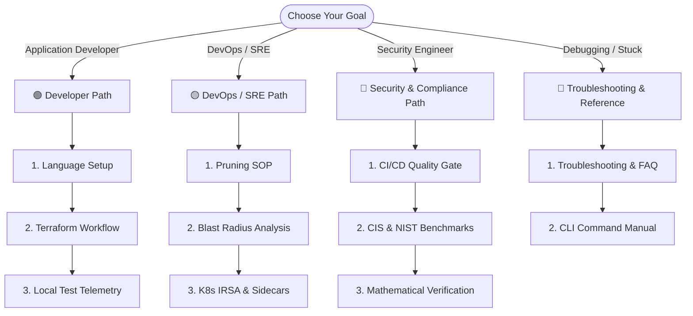
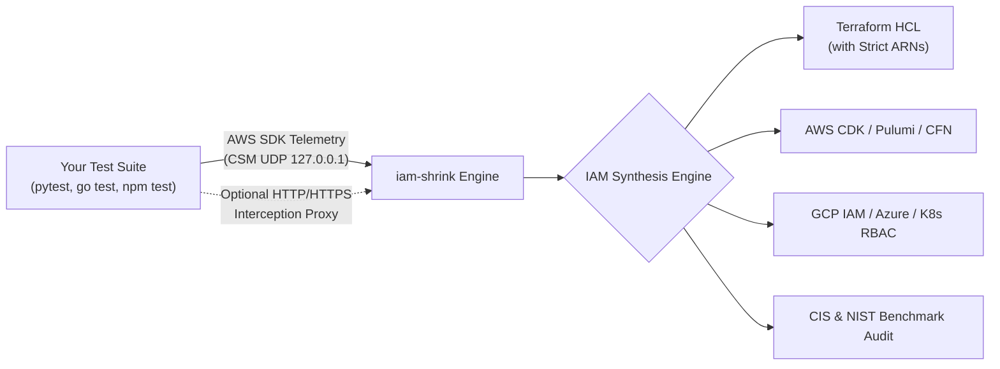

# iam-shrink Documentation

> **Local-to-Least-Privilege AWS IAM Policy Generator**
> Intercept AWS operations during local test suites, scripts, or deployment dry runs and automatically synthesize exact, least-privilege IAM policies with **zero cloud credentials**.

---

## Recommended Reading Paths by Persona

To find the exact information you need without getting overwhelmed, follow the reading path tailored to your role:



### 🟢 Developer Path (Fast Local Policies)
*If you are writing code and want to generate least-privilege policies from your test suite:*
1. **[Language & SDK Playbooks](guides/02-language-integrations.md)**: Zero-config setup for Python (`pytest`), Node.js (`jest`), Go, Java, and Docker.
2. **[Terraform & OpenTofu Workflow](guides/03-terraform-and-opentofu.md)**: Replace wildcards in `.tf` files in-place (`iam-shrink patch`) and resolve runtime ARNs from state.
3. **[Tutorial 01: Local Test Suite Telemetry](examples/01-local-test-runner.md)**: Runnable walkthrough capturing AWS calls in real time.

---

### 🟡 DevOps & SRE Path (Safe Production Operations)
*If you manage cloud infrastructure and need to clean up legacy roles without breaking production:*
1. **[Enterprise Legacy Role Pruning Runbook](guides/04-legacy-role-pruning-runbook.md)**: A 6-phase standard operating procedure (SOP) to safely remove 85%+ unused actions.
2. **[Blast Radius & Impact Analysis](guides/05-blast-radius-and-impact.md)**: Replay 90 days of CloudTrail traffic to verify safety scores before deployment.
3. **[Kubernetes IRSA & Multi-Cloud](guides/07-multi-cloud-and-k8s.md)**: In-cluster pod telemetry sidecars and translating AWS policies to GCP Custom Roles or Azure RBAC.

---

### 🔴 Security & Compliance Path (Shift-Left Guardrails)
*If you are auditing permissions, enforcing organizational standards, or securing CI/CD pipelines:*
1. **[CI/CD Security Quality Gates & PR Bot](guides/06-ci-cd-quality-gates.md)**: Block wildcard PRs and post automated IAM diff reviews.
2. **[Compliance Benchmarks (CIS & NIST)](guides/08-compliance-benchmarks.md)**: Audit policies against CIS AWS Foundations Benchmark v3.0 and NIST SP 800-53.
3. **[Architecture & Telemetry Deep-Dive](guides/01-architecture-and-telemetry.md)**: Learn how loopback UDP CSM and the ephemeral CA interception proxy operate under the hood.

---

### 🔵 Troubleshooting & Reference Path
*If you are encountering an issue or need exact flag syntax:*
* **[Troubleshooting & Frequently Asked Questions (FAQ)](guides/09-troubleshooting-and-faq.md)**: Solutions for "0 calls captured", proxy SSL certificates, and Docker bridging.
* **[Complete CLI Command & Flag Reference](reference/cli-reference.md)**: Comprehensive manual covering all 20 subcommands and parameters.

---

## What is iam-shrink? (In Simple Terms)

When developers write code that talks to AWS (like reading from an S3 bucket or saving to DynamoDB), they usually do not know the exact list of obscure AWS IAM action names and ARNs required.

Because getting "Access Denied" errors slows down development, developers routinely slap on `AdministratorAccess` or broad wildcard policies (`Action: "*", Resource: "*"`). These over-privileged policies make it into staging and production, exposing organizations to massive data breaches and compliance audit failures.

**`iam-shrink` solves this automatically.**

It acts like a transparent observer. When you run your existing test suite, `iam-shrink` quietly watches every AWS call your code makes in real time with **zero cloud credentials**. It then writes the **exact, minimal security policy** needed to run your application—formatted in **Terraform HCL**, **AWS CDK**, **CDKTF**, **Pulumi**, **CloudFormation**, **AWS Identity Center (SSO)**, **GCP IAM**, **Azure RBAC**, **Kubernetes RBAC**, or **JSON**.

---

## How It Works: Zero-Credential Observation



1. **Local Interception**: Prefix your test command with `iam-shrink run -- <cmd>`. `iam-shrink` starts a lightweight loopback UDP listener on `127.0.0.1` and passes `AWS_CSM_ENABLED=true` to the test process.
2. **Standard AWS SDK Telemetry**: Every official AWS SDK (Go, Python/Boto3, Node.js, Java, .NET) natively emits microsecond telemetry datagrams for every API call made.
3. **Instant Synthesis**: When the command finishes, `iam-shrink` correlates the calls, looks up IAM permissions in its embedded database, parameterizes ARNs, and generates clean infrastructure code.

---

## Quickstart: Choose Your Stack

Run `iam-shrink` with your preferred programming language and testing framework:

```bash
# Go (go test)
iam-shrink run --format=tf --strict-arns --emit-vars -- go test ./...

# Python (pytest + boto3)
iam-shrink run --format=tf --strict-arns -- pytest tests/

# Node.js / TypeScript (Jest / Vitest + @aws-sdk)
iam-shrink run --format=cdk -- npm test

# Terraform Dry-Run (Capture permissions needed for terraform plan)
iam-shrink run --format=tf --strict-arns -- terraform plan

# Multi-Cloud (Google Cloud Custom Role from Python tests)
iam-shrink run --format=gcp -- pytest tests/

# Docker (Zero-install wrapper for any repository)
docker run --rm -v $(pwd):/workspace -w /workspace \
  ghcr.io/smford/iam-shrink:latest run --format=tf -- pytest
```

---

## Why iam-shrink vs Alternatives?

| Capability | `iam-shrink` | AWS IAM Access Analyzer | Policy Sentry | CloudTracker |
|---|:---:|:---:|:---:|:---:|
| **Feedback Loop** | **Instant (Local Test Run)** | Delayed (15-30m CloudTrail) | Manual list compile | Batch CloudTrail sync |
| **AWS Credentials Required?** | **No (Zero-Cloud Loopback)** | Yes (Live AWS Account) | No | Yes (AWS Athena/S3) |
| **In-Place Terraform Patching** | **Yes (`iam-shrink patch`)** | No | No | No |
| **Multi-Cloud (GCP, Azure, K8s)** | **Yes (Native Translation)** | AWS Only | AWS Only | AWS Only |
| **Operational Blast Radius** | **Yes (`iam-shrink impact`)** | Basic | No | Read-only diff |
| **CI/CD Quality Gate & PR Diff** | **Yes (Action & CLI)** | External check | No | No |
| **AWS Quota Compression** | **Yes (30-50% Byte Reduction)** | No | No | No |

---

## Interactive Worked Tutorials

Each tutorial is completely self-contained with runnable scripts and pre-committed output artifacts:

| Tutorial | Description | Link |
|---|---|:---:|
| **01. Local Test Telemetry** | Capture calls from Go, Python, and Node.js test suites. | [Read Tutorial](examples/01-local-test-runner.md) |
| **02. CloudTrail Ingestion** | Synthesize policies directly from historical audit logs. | [Read Tutorial](examples/02-cloudtrail-ingest.md) |
| **03. In-Place Terraform Patching** | Update `.tf` files in-place with automated `.bak` backups. | [Read Tutorial](examples/03-terraform-patching.md) |
| **04. CI/CD Quality Gate** | Block wildcards in CI and generate formatted PR comments. | [Read Tutorial](examples/04-ci-cd-quality-gate.md) |
| **05. Verification & Blast Radius** | Mathematically prove subset boundaries and score safety. | [Read Tutorial](examples/05-policy-verification-and-blast-radius.md) |
| **06. Legacy IAM Role Pruning** | Prune 85%+ unused actions safely from bloated roles. | [Read Tutorial](examples/06-legacy-role-pruning.md) |
| **07. Kubernetes IRSA & Multi-Cloud** | Pod telemetry sidecars, GCP Custom Roles, and Azure RBAC. | [Read Tutorial](examples/07-kubernetes-irsa-and-multi-cloud.md) |
