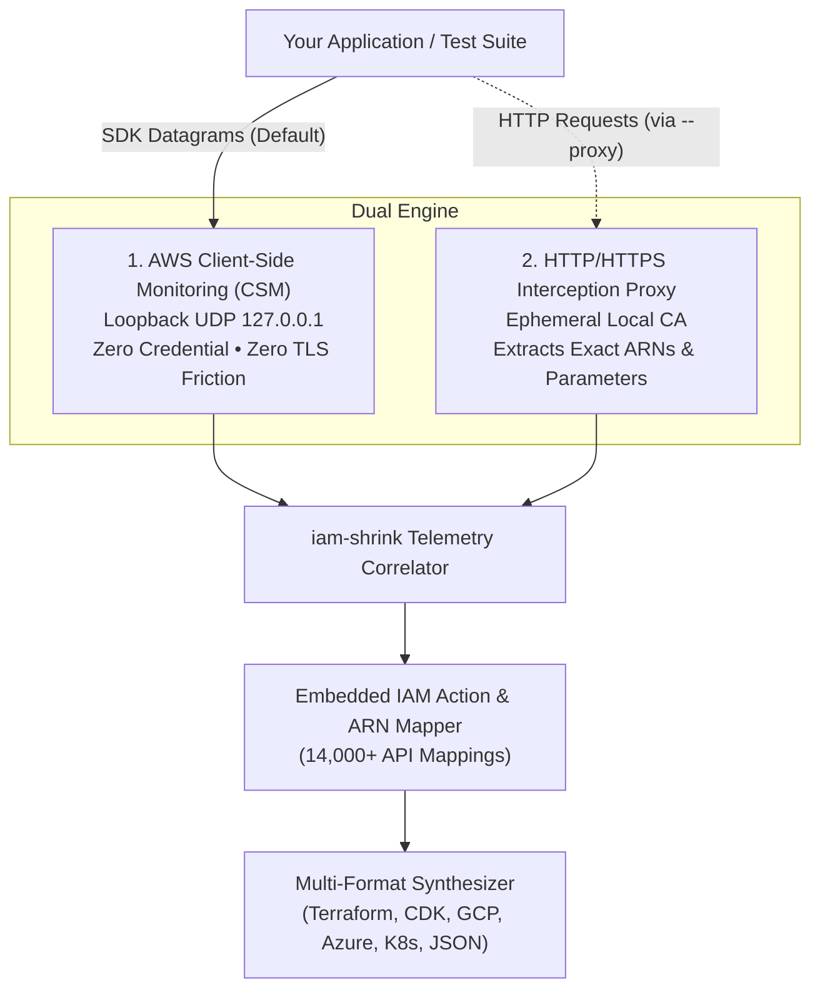

# Architecture & Telemetry Deep-Dive

This guide explains the inner workings of `iam-shrink`'s telemetry engine, the difference between **Client-Side Monitoring (CSM)** and the **Interception Proxy**, and how `iam-shrink` synthesizes production-ready security policies with zero cloud credentials.

---

## The Core Telemetry Problem

To generate a least-privilege IAM policy, you need two pieces of information:
1. **The IAM Action:** The exact permission name required by AWS (e.g. `s3:GetObject` or `dynamodb:PutItem`).
2. **The Target Resource ARN:** The specific AWS resource receiving the action (e.g. `arn:aws:s3:::my-bucket/orders/*` or `arn:aws:dynamodb:us-east-1:123456789012:table/Orders`).

AWS SDK calls do not pass IAM action names directly; they call service methods (like `client.get_object(...)`). Furthermore, standard AWS SDK telemetry was designed for latency tracking rather than security auditing.

`iam-shrink` solves this with a **Dual Interception Engine**:



---

## Mode 1: Client-Side Monitoring (CSM) Telemetry

### How AWS CSM Works
All official AWS SDKs (Go v2, Python Boto3, Node.js `@aws-sdk`, Java v2, .NET, Ruby, PHP) include a built-in Client-Side Monitoring client. When the environment variable `AWS_CSM_ENABLED=true` is present, the SDK broadcasts UDP datagrams to `127.0.0.1:<port>` for every API call made.

### Datagram Schema
Every AWS SDK emits a JSON payload structured according to the official AWS CSM specification:

```json
{
  "Version": 1,
  "ClientId": "my-application",
  "Type": "ApiCall",
  "Service": "S3",
  "Api": "GetObject",
  "Timestamp": 1729584000000,
  "Region": "us-east-1",
  "AttemptCount": 1,
  "Latency": 42,
  "HttpStatusCode": 200,
  "FinalHttpStatusCode": 200
}
```

### Advantages of CSM
* **Zero Credentials Required:** The test does not need valid AWS keys, IAM roles, or AWS STS tokens. Even if the SDK fails with `NoCredentialsError` or mock errors, the CSM datagram is emitted before the network request departs.
* **Zero TLS/Certificate Friction:** Because communication occurs over raw UDP loopback, there are no TLS handshake issues, certificate verification warnings, or CA trust store modifications.
* **Microsecond Overhead:** UDP broadcast is asynchronous and non-blocking in modern AWS SDKs, adding under 0.05ms of overhead to test execution.

### Limitations of CSM
The official AWS CSM schema **only reports the service name and API operation**. It does not include target resource names (e.g. bucket names or table names). Therefore, standard CSM output parameterizes resources using variables (`arn:aws:s3:::${var.bucket_name}/*`) or wildcards (`*`).

---

## Mode 2: Ephemeral Interception Proxy (`--proxy`)

When you require **exact, concrete resource ARNs** without manual variable parameterization, enable the HTTP/HTTPS interception proxy:

```bash
iam-shrink run --proxy --format=tf -- pytest tests/
```

### How the Proxy Works
1. `iam-shrink` generates an in-memory, ephemeral Root Certificate Authority (CA) upon startup.
2. It starts a local HTTP/HTTPS forward proxy on `127.0.0.1:<random_port>`.
3. It sets environment variables in the test process:
   * `HTTP_PROXY=http://127.0.0.1:<port>`
   * `HTTPS_PROXY=http://127.0.0.1:<port>`
   * `AWS_CA_BUNDLE=/path/to/ephemeral-ca.pem`
   * `SSL_CERT_FILE=/path/to/ephemeral-ca.pem`
   * `NODE_EXTRA_CA_CERTS=/path/to/ephemeral-ca.pem`
4. When your application makes an outbound call to an AWS endpoint (e.g. `https://my-bucket.s3.us-east-1.amazonaws.com/orders/2026.json`):
   * The proxy intercepts the request.
   * It parses the Host header, URI path, and request body (JSON/XML).
   * It extracts the concrete bucket name (`my-bucket`), key prefix (`orders/*`), DynamoDB table name, or KMS Key ID.
5. Upon process exit, the ephemeral CA certificates and files are securely deleted from disk.

---

## Mode 3: Standalone Daemon Session Mode (`session`)

When your tests run across multiple distinct commands, containers, or background workers, you cannot wrap them in a single `iam-shrink run -- <cmd>` call. Use session mode:

```bash
# 1. Start background collector daemon
iam-shrink session start --port=31000

# 2. Configure your environment or containers
export AWS_CSM_ENABLED=true
export AWS_CSM_PORT=31000
export AWS_CSM_HOST=127.0.0.1

# 3. Run multiple independent test suites
pytest tests/unit/
npm run test:integration
go test ./services/...

# 4. Check active collection status
iam-shrink session status

# 5. Dump the unified least-privilege policy across all test runs
iam-shrink session dump --format=tf --strict-arns --out=unified_policy.tf

# 6. Stop the daemon
iam-shrink session stop
```

---

## Comparison: When to Use Which Telemetry Mode

| Feature / Requirement | Standard CSM (`run`) | Proxy Mode (`--proxy`) | CloudTrail (`ingest`) | Session (`session`) |
|---|:---:|:---:|:---:|:---:|
| **Zero AWS Credentials Needed** | ✅ Yes | ✅ Yes | ❌ Requires CloudTrail Logs | ✅ Yes |
| **No TLS / Certificate Setup** | ✅ Zero TLS | ⚠️ Uses Ephemeral CA | ✅ Offline Analysis | ✅ Zero TLS |
| **Exact Resource ARNs** | Parameterized (`${var.x}`) | ✅ Concrete ARNs | ✅ Concrete ARNs | Parameterized |
| **Multi-Process / Container Support** | Single command | Single command | Batch log files | ✅ Distributed |
| **Execution Speed** | Instant (<0.2s) | Instant (<0.3s) | Instant (Log parse) | Continuous |
