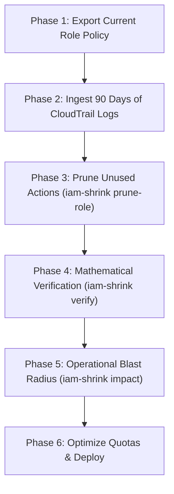

[← Documentation Hub](../index.md)

# Enterprise Legacy Role Pruning Runbook

This runbook provides a battle-tested, standard operating procedure (SOP) for infrastructure and security teams to safely prune bloated, overprivileged AWS IAM roles.

Following this procedure guarantees:
1. **Zero Shadow Privilege Escalation** (formally verified).
2. **Zero Production Downtime** (blast-radius simulated against 90 days of CloudTrail).
3. **80–95% Reduction** in IAM attack surface.

---

## The 6-Phase Pruning Workflow



---

## Phase 1: Export Current Policy

Export the currently deployed IAM policy from AWS:

```bash
aws iam get-role-policy \
  --role-name "legacy-production-worker" \
  --policy-name "worker-permissions" \
  --query "PolicyDocument" \
  --output json > legacy_role.json
```

---

## Phase 2: Harvest CloudTrail Logs

Export 30 to 90 days of historical CloudTrail event records from Amazon S3 or via Amazon Athena into a local directory:

```bash
# Example S3 sync from CloudTrail bucket
aws s3 sync s3://my-org-cloudtrail/AWSLogs/123456789012/CloudTrail/us-east-1/2026/ ./cloudtrail_logs/
```

Or query active actions using `iam-shrink ingest`:
```bash
iam-shrink ingest ./cloudtrail_logs/ --out=observed_active.json
```

---

## Phase 3: Prune Dead Permissions (`iam-shrink prune-role`)

Prune all permissions that were not observed in active production use:

```bash
iam-shrink prune-role \
  --active-actions="s3:GetObject,s3:PutObject,dynamodb:PutItem,kms:Decrypt" \
  --out=candidate_shrunk_role.json \
  legacy_role.json
```

*Sample CLI Output:*
```text
Pruning complete: Removed 42 actions (87.5% attack surface reduction).
Candidate policy written to candidate_shrunk_role.json.
```

---

## Phase 4: Formally Verify Subset Equivalence (`iam-shrink verify`)

Before deploying any pruned policy, verify that the candidate policy **only removes permissions** and introduces **zero unintended wildcard expansions or shadow permissions**:

```bash
iam-shrink verify legacy_role.json candidate_shrunk_role.json
```

*Expected Result:*
```text
✓ Verification PASS: Shrunk policy is a strict mathematical subset of the base policy.
  Reduction: reduced from 48 base permissions to 6 active permissions.
  Shadow expansions: 0 (no ungranted actions or wildcard escalations detected).
```

If `iam-shrink verify` exits with code `1`, halt the rollout immediately and inspect the flagged discrepancies.

---

## Phase 5: Operational Blast Radius Analysis (`iam-shrink impact`)

Test the candidate policy against the real historical traffic to ensure periodic jobs (like month-end billing or disaster recovery drills) will not be severed:

```bash
iam-shrink impact ./cloudtrail_logs/ candidate_shrunk_role.json
```

*Evaluating the Output:*
* **Safety Score $\ge$ 99.0% [MINIMAL RISK]:** Safe to proceed.
* **Severed Calls Detected:** Review the flagged operations. If a severed call corresponds to an intentional decommission, proceed. If it corresponds to a quarterly cron job, add the permission back to `--active-actions`.

---

## Phase 6: Quota Optimization & Production Rollout

### 1. Optimize Policy Size
Ensure the shrunk policy does not breach AWS inline (2,048B) or managed (10,240B) quotas:
```bash
iam-shrink optimize --check candidate_shrunk_role.json
iam-shrink optimize --out=final_policy.json candidate_shrunk_role.json
```

### 2. Canaried Production Rollout
1. Apply the policy to a staging or pre-production environment for 7 days.
2. Monitor CloudWatch metrics for `AccessDenied` spikes using CloudWatch Insights:
   ```text
   fields @timestamp, eventName, errorMessage
   | filter errorCode = "AccessDenied"
   | stats count(*) by eventName
   ```
3. Apply to production via Terraform or OpenTofu.

---

**Navigation:** [← Previous: Kubernetes & Multi-Cloud](07-multi-cloud-and-k8s.md) | [Next: Blast Radius Analysis →](05-blast-radius-and-impact.md)
