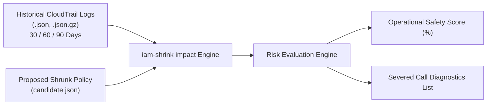

[← Documentation Hub](../index.md)

# Operational Blast Radius & Blast Impact Analysis

This guide explains how `iam-shrink impact` evaluates proposed IAM policies against real historical AWS CloudTrail audit logs to quantify operational risk, identify severed operations, and prevent production outages.

---

## Why Blast Radius Analysis is Critical

When security teams attempt to implement least-privilege, operations teams frequently resist out of fear:
* *"What if removing `s3:*` breaks our month-end financial reconciliation job?"*
* *"What if removing `ec2:DescribeInstances` breaks our quarterly disaster recovery failover drill?"*

Traditional static policy linters cannot answer these questions because they only inspect syntax, not runtime history. `iam-shrink impact` bridges this gap by replaying historical CloudTrail logs through the proposed policy.

---

## How `iam-shrink impact` Works



1. **Log Parsing:** Reads individual `.json` event files or compressed `.json.gz` log archives from CloudTrail directories.
2. **Policy Evaluation:** For every recorded event, `iam-shrink` checks whether the event's `eventSource` and `eventName` would be permitted under the candidate policy's `Statement` rules.
3. **Safety Score Calculation:** Computes the percentage of historical calls permitted:
   $$\text{Operational Safety Score} = \left( \frac{\text{Permitted Events}}{\text{Total Events}} \right) \times 100\%$$
4. **Severed Call Extraction:** Flags any event that succeeded in the past but would now receive an `AccessDenied` error.

---

## Running Blast Radius Analysis

### Basic Command
```bash
iam-shrink impact /var/log/cloudtrail/ proposed_policy.json
```

### Sample Terminal Output
```text
=== Operational Blast Radius & Impact Analysis ===

  Historical Events Analyzed: 14,820
  Permitted by Shrunk Policy: 14,818 (99.98%)
  Potentially Severed Calls:  2
  Operational Safety Score:   99.9% [MINIMAL RISK]

⚠️  The following historical calls would be SEVERED if this policy is applied:
    SERVICE / API        IAM ACTION               OCCURRENCES   LAST OBSERVED
    -------------------------------------------------------------------------
    s3:DeleteBucket      s3:DeleteBucket          1             2026-09-15
    dynamodb:DeleteTable dynamodb:DeleteTable     1             2026-08-01

Recommendation: Verify if severed operations represent periodic background jobs, DR drills, or legitimate application workflows before deploying.
```

---

## Risk Classifications

| Safety Score | Risk Tier | Recommended Action |
|---|:---:|---|
| **99.0% – 100.0%** | 🟢 **MINIMAL RISK** | Safe to apply. All common operations are fully retained. Review the 1–2 severed calls to confirm they were one-off manual actions. |
| **90.0% – 98.9%** | 🟡 **MODERATE RISK** | Investigate severed calls. Likely missing permissions for infrequent background jobs or cron scripts. |
| **< 90.0%** | 🔴 **HIGH RISK** | Do not deploy. Core application workflows will fail. Expand active actions before re-evaluating. |

---

## Automating in CI/CD Pipelines

You can enforce blast radius thresholds directly inside deployment pipelines:

```bash
# Fail CI build if safety score drops below 99.5%
iam-shrink impact --min-score=99.5 /var/log/cloudtrail/ candidate_policy.json

# Fail CI build if any call is severed
iam-shrink impact --fail-on-severed /var/log/cloudtrail/ candidate_policy.json
```

---

**Navigation:** [← Previous: Legacy Role Pruning SOP](04-legacy-role-pruning-runbook.md) | [Next: CI/CD Quality Gates & PR Bot →](06-ci-cd-quality-gates.md)
